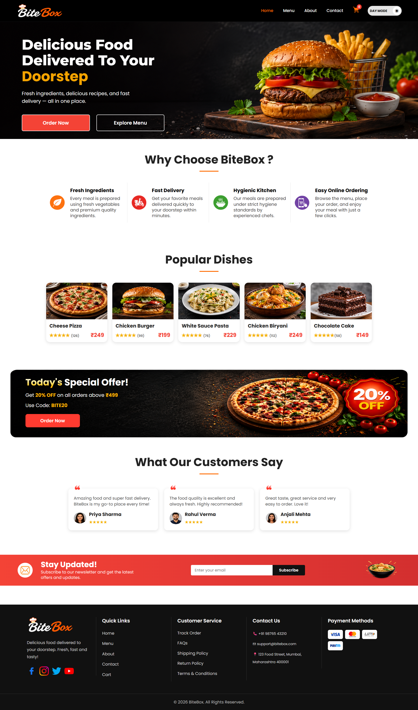
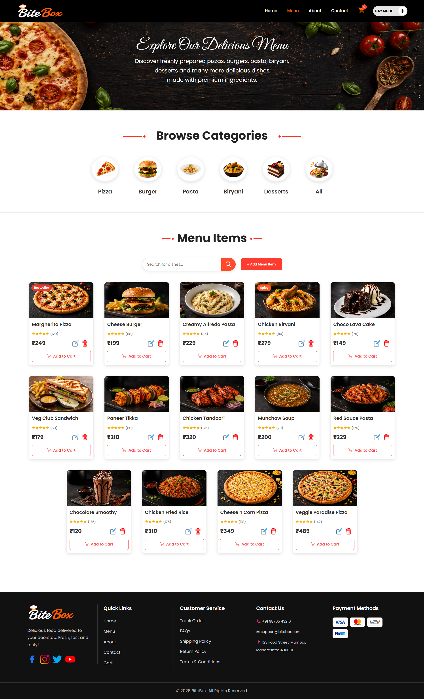
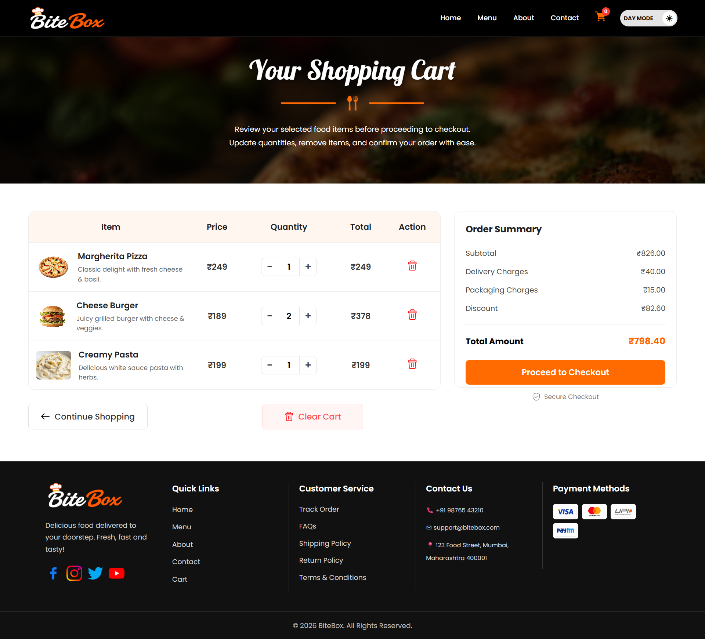

# 🍔 BiteBox | Food Delivery Website

**BiteBox** is a frontend food delivery website developed using HTML5, CSS3, and JavaScript. The project focuses on creating a user-friendly interface with dedicated pages for browsing food, viewing menu items, managing the cart, and contacting the platform.


## 🌐 Live Website

🔗 [Click Here to Visit BiteBox](https://bitebox-beta.vercel.app/)

## 🚀 Project Overview

BiteBox is a frontend web development project built to demonstrate practical knowledge of modern web fundamentals, page structuring, styling, and JavaScript-based interactivity.

## ✨ Pages & Modules

| Page | File | Description |
|---|---|---|
| Home | `index.html` | Main landing page |
| About | `about.html` | About the BiteBox platform |
| Menu | `menu.html` | Food menu page |
| Cart | `cart.html` | Shopping cart page |
| Contact | `contact.html` | Contact page |

## 🛠️ Technologies Used

- **HTML5** – Website structure and content
- **CSS3** – Styling, layouts, and visual design
- **JavaScript** – Frontend interactivity and functionality

## 📂 Project Structure

```text
BiteBox/
│
├── assets/
│   ├── icons/
│   └── images/
│
├── css/
│   ├── about.css
│   ├── cart.css
│   ├── contact.css
│   ├── index.css
│   ├── menu.css
│   └── style.css
│
├── js/
│   └── script.js
│
├── about.html
├── cart.html
├── contact.html
├── index.html
├── menu.html
│
└── README.md
```

## ⚙️ Getting Started

Follow these steps to run the project on your local machine.

### 1. Clone the Repository

```bash
git clone https://github.com/Vijaytupe/BITE_BOX.git
```

### 2. Navigate to the Project Folder

```bash
cd BITE_BOX
```

### 3. Run the Project

Open `index.html` in your browser.

**Recommended:** Use the Live Server extension in Visual Studio Code for local development.

## 📸 Project Preview


### Home Page


### Menu Page


### Cart Page



## 🎯 Key Learning Objectives

- Building multi-page websites using HTML5.
- Creating reusable and organized CSS stylesheets.
- Implementing frontend functionality using JavaScript.
- Managing project assets and folder structures.
- Understanding real-world frontend project organization.

## 🔮 Future Enhancements

- User authentication and registration.
- Dynamic shopping cart functionality.
- Food search and filtering.
- Backend integration.
- Database management.
- Online payment integration.
- Order management and tracking.

## 👨‍💻 Developer

**Vijay Tupe**

- GitHub: [GitHub Profile](https://github.com/Vijaytupe)
- LinkedIn: [LinkedIn Profile](https://www.linkedin.com/in/vijay-tupe-016897357/)

## 📄 License

This project is developed for educational and portfolio purposes.

---

⭐ If you like this project, consider giving it a star!

**BiteBox – Your Cravings, One Click Away! 🍔**
